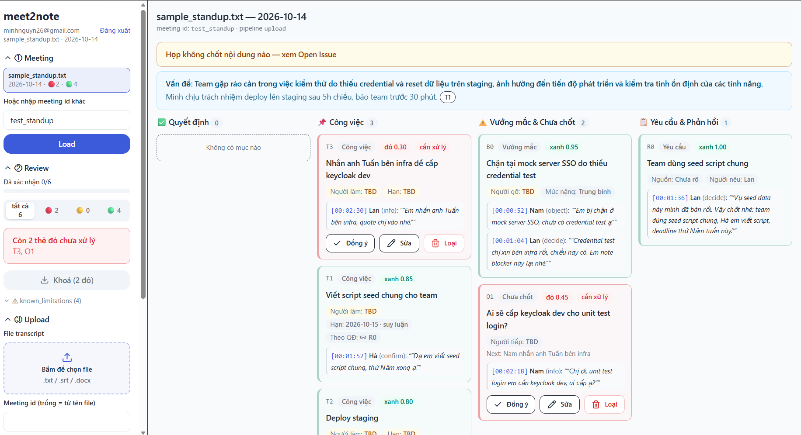

<div align="center">

# meet2note

**Biến transcript cuộc họp thành dữ liệu dùng được** — quyết định cuối, công việc có owner/deadline, vướng mắc — kèm evidence truy vết tới từng câu nói.

[](https://www.python.org/)
[](backend/api.py)
[](frontend/)
[](docker-compose.yml)
[](docs/runbook/local-dev.md)
[](tests/)
[](https://github.com/TrungHocCode/meet2note/pulls)

*Triết lý: **LLM đề xuất, code kiểm chứng, con người chốt.***

</div>

---

## Vấn đề

Một cuộc họp 60 phút thường chỉ còn lại 3–5 quyết định và 5–8 task — nhưng biên bản tay
hoặc AI tóm tắt naive gây ra 3 nỗi đau đắt nhất:

| Nỗi đau | Hậu quả |
|---|---|
| **Sai / trôi quyết định cuối** — đầu họp đề xuất A, cuối họp chốt B, biên bản liệt kê ngang nhau | Team thi công nhầm A, chi phí sửa gấp 10–50 lần chi phí ghi |
| **Task mồ côi** — "anh em triển khai nhé", "sớm nhé" | Không owner, không deadline → việc rơi vào khoảng trống, phải họp lại |
| **Mất ngữ cảnh** — vì sao đổi A→B, ai phản đối? | Người nghỉ việc mang theo lý do, công ty trả tiền học lại |

## Giải pháp

Luồng 4 bước, dưới 5 phút:

```
Upload transcript → AI trích state → Host review 2 phút → Export minutes + Jira CSV
```

- **State, not summary**: 6 loại item (Decision / Task / Blocker / Requirement / Open Issue / Knowledge), không phải đoạn văn tóm tắt.
- **Evidence-first**: mọi item bấm vào thấy câu gốc + timestamp + speaker trong transcript.
- **Human-confirm trước khi sync**: gate R6 khóa export đến khi hết thẻ đỏ 🔴.
- **Trung thực mặc định**: không suy ra được → `TBD` + `known_limitations`, không bịa.

<p align="center">
  
  <br /><em>Giao diện review: 4 cột + badge confidence + drawer transcript</em>
</p>

## Tính năng

| # | Tính năng | Mô tả |
|---|---|---|
| 1 | Upload + chạy pipeline | `.txt` / `.srt` / `.docx` → trích xuất qua Ollama local, state hiện ngay để review |
| 2 | Review 2 phút | Kanban 4 cột, badge 🔴<0.50 / 🟡0.50–0.75 / 🟢≥0.75, Đồng ý / Sửa / Loại từng thẻ |
| 3 | Truy vết evidence | Bấm timestamp → drawer transcript ±4 turns quanh câu gốc |
| 4 | Xử lý đảo ngược A→B→A | Giữ vết `supersedes`, quyết định bị lật thành `discarded`, mâu thuẫn không giải được → flag + Open Issue |
| 5 | Gate R6 | Còn thẻ đỏ chưa xử lý → export bị khóa cả ở UI lẫn API |
| 6 | Export + tải về | `minutes.md` + `tasks_jira.csv`, nút tải trực tiếp về máy |
| 7 | Multi-user | JWT (access 60p + refresh httpOnly 7 ngày), mỗi user chỉ thấy meeting của mình |
| 8 | Danh sách meeting | Bấm xem lại kết quả cũ, không cần nhớ id |
| 9 | Cổng kiểm chứng M3 (`gates.py`) | Chống chốt giả 3 điều kiện (M3-A), chặn câu hedge mơ hồ (M3-B), phạt thiếu chuỗi diễn biến (M3-C), tự phân loại lại Task ↔ Knowledge (M3-D), cập nhật deadline/owner sửa giữa họp kèm vết (CR) |

## Ví dụ Input → Output

**Input** (`[00:10:12] Nam: đề xuất phương án A` … `[00:45:30] Lan: A rủi ro chi phí, chốt B, cả team đồng ý`):

```markdown
## Quyết định
- ✅ **Chốt phương án B** (thay A) — người chốt: Lan
  supersedes: A · evidence: [00:45:30] Lan · confidence: 0.90 🟢

## Công việc
- [ ] Nam gửi báo giá B trước 12/10 → link tới Quyết định B
```

## Tech stack

| Lớp | Công nghệ |
|---|---|
| Pipeline lõi | Python 3.11, Pydantic v2, rules R1–R8 kiểm chứng bằng code |
| LLM | Ollama local (`qwen3:4b-instruct-2507-q4_K_M`), JSON mode + constrained decoding, fallback tên `OPENAI_*` |
| API | FastAPI, JWT HS256 + refresh opaque, SQLAlchemy + Alembic |
| DB | Postgres 16 (Docker, port host `5434`), 5 bảng metadata — file vẫn nằm trên disk |
| UI | React 18, Vite, Tailwind v4, shadcn, localStorage token + refresh cookie |

## Chạy nhanh

```powershell
# 0. Yêu cầu: Python 3.11+, Node 18+, Docker, Ollama + model qwen3:4b-instruct-2507-q4_K_M
cd meet2note   # thư mục repo vừa clone
# Windows dùng .\.venv\Scripts\python.exe, Linux/Mac dùng .venv/bin/python
# (các lệnh dưới viết theo Windows — đổi tương ứng khi dùng hệ khác)

Copy-Item .env.example .env   # điền LLM_BASE_URL, LLM_MODEL, JWT_SECRET (xem § Cấu hình)
.\.venv\Scripts\python.exe -m pip install -r requirements.txt

docker compose up -d db
.\.venv\Scripts\python.exe -m backend.db_cli migrate
.\.venv\Scripts\python.exe -m backend.db_cli create-admin --email <email> --password <pass-8+kt>

# 2 terminal riêng:
.\.venv\Scripts\python.exe -m uvicorn backend.api:app --port 8000
cd frontend; npm install; npm run dev     # http://localhost:5173
```

Đăng nhập → Upload transcript → Review → Export → Tải file. Chi tiết từng lớp: [`docs/runbook/local-dev.md`](docs/runbook/local-dev.md).

## Cấu hình (`.env`)

| Biến | Bắt buộc | Mặc định | Mô tả |
|---|---|---|---|
| `LLM_BASE_URL` | ✓ | `http://localhost:11434/v1` | Endpoint OpenAI-compatible (Ollama local) |
| `LLM_MODEL` | ✓ | `qwen3:4b-instruct-2507-q4_K_M` | Model trích xuất |
| `LLM_TIMEOUT` / `LLM_NUM_CTX` / `LLM_JSON_MODE` | – | `300` / `8192` / `1` | Timeout, context, ép JSON |
| `JWT_SECRET` | ✓ (khi chạy API) | – | Chuỗi ngẫu nhiên dài, **không commit** |
| `DATABASE_URL` | – | `…@localhost:5434/meet2note` | Đổi khi dùng PG khác |

## API tổng quan

Đầy đủ: [`docs/spec/api-contract.md`](docs/spec/api-contract.md).

| Method | Path | Auth | Mô tả |
|---|---|---|---|
| `POST` | `/auth/register` · `/auth/login` · `/auth/refresh` · `/auth/logout` | Mở / cookie | Vòng đời tài khoản + phiên |
| `GET` | `/auth/me` | Bearer | Thông tin user |
| `GET` | `/api/v1/meetings` | Bearer | Danh sách meeting của mình |
| `GET` / `PUT` | `/api/v1/review?meeting=` | Bearer + owner | Đọc / chốt state (+ `changes` audit) |
| `POST` | `/api/v1/export?meeting=` | Bearer + owner | Gate R6 → sinh files |
| `GET` | `/api/v1/export/file?meeting=&name=` | Bearer + owner | Tải `minutes.md` / `tasks_jira.csv` |
| `GET` | `/api/v1/transcript?meeting=` | Bearer + owner | Turns transcript cho drawer |
| `POST` | `/api/v1/meetings/upload` | Bearer | Upload + chạy pipeline + ghi DB |

## Test cases

6 ca synthetic (`data/transcripts/` + `data/golden/`), chấm chi tiết trong [`eval/report.md`](eval/report.md):

| Ca | Kịch bản | Kỳ vọng |
|---|---|---|
| **tc1** sprint planning | Ngày vui vẻ + chốt giả ("chốt nghỉ trưa"), decoy | D.final đúng người chốt, 3 task đủ owner+due, chốt giả bị loại |
| **tc2** đảo A→B ⭐ | Kill-criterion: đề xuất A, cuối chốt B | `D1.final=B`, `supersedes=[D0]`, task link D1 |
| **tc3** brainstorm vòng vo | Không chốt gì + bẫy "chốt luôn" bị bác ngay | `no_decision=true`, Open Issue có next_step, không bịa Decision |
| **tc4** entity-linking | Đại từ ("em", "anh") + ngày tương đối | owner/due đúng ISO; không suy được → `TBD` |
| **tc5** đảo A→B→A | Mâu thuẫn không giải được | Flag `unresolved_reversal` + Open Issue — trung thực hơn đúng |
| **tc6** họp dài 3 chủ đề (M3) | ~110 turns: chốt giả bị bác + hedge + sửa deadline `16→21/10` + quy ước dài hạn | `false_final=0`, due lấy lần sửa cuối có vết, Task quy ước → Knowledge |

```powershell
.\.venv\Scripts\python.exe -m pipeline.cli eval --cases tc1,tc2,tc3,tc4,tc5,tc6  # fixture → 6/6 PASS
.\.venv\Scripts\python.exe -m pipeline.cli eval --live                           # LLM thật so golden → 5/5 PASS
.\.venv\Scripts\python.exe -m pytest tests -q                                    # 287 passed, 1 skipped
cd frontend; npm run build                                                       # verify UI
```

Chi tiết 8 quy tắc cứng R1–R8: [`AGENTS.md`](AGENTS.md) §4.

## Cấu trúc repo

```
pipeline/   ingest → extract → resolve (+ gates M3) → verify → export → service → cli (lõi độc lập)
backend/    api.py (lớp mỏng) · auth.py (JWT) · db/ (models/session) · db_cli.py (migrate/seed/sync)
frontend/   review 4 cột + brief + drawer transcript + upload + login
prompts/    system_extract / resolve / brief + fewshot (tách khỏi code)
data/       transcripts/ meta/ golden/ — BẮT BUỘC synthetic (repo public)
eval/       runner.py + report.md + results_fixture/live/tc6_*.json
tests/      pytest trên sqlite tmp (không chạm PG local)
docs/       c4/ (kiến trúc) · adr/ (quyết định) · spec/ (hợp đồng) · runbook/ · slides/ · images/
runs/       output versioned — gitignored
```

## Lộ trình

- [x] P0–P4: pipeline + API + review UI + eval MVP
- [x] P5: upload + transcript viewer + `.docx`
- [x] P6: Postgres metadata + JWT multi-user + owner isolation
- [x] UI polish: empty state, meeting list, download, chống giãn layout
- [x] Mission 3 (M3): Decision Gate 3ĐK + Hedge Gate + Evidence-chain + Task↔Knowledge + CR sửa deadline/owner (`tc6_long`)
- [ ] Pilot họp thật: đo Decision Accuracy >95%, Task Usability >85%, Time-to-value <5 phút
- [ ] Sau MVP: templates theo loại họp, sync Jira/Slack 1-chiều, Decision Search / Q&A xuyên họp, SSO + redaction PII

## Đóng góp

GitHub Flow: `main` luôn xanh — mọi thay đổi qua branch `feat/*` + PR (squash-merge),
không push thẳng `main`. Quy ước chi tiết: [`AGENTS.md`](AGENTS.md).

**Không bao giờ commit**: `.env`, transcript thật, `docs/private/`, `runs/`, file log server.

## Known limitations

- Model local nhỏ paraphrase + variance theo input (lưới R1–R8 + M3 gates đỡ, không che) — xem `eval/report.md`.
- Cổng M3-A quét câu rút lại trong cửa sổ ±5 turns sau câu chốt; bộ từ khóa hedge tiếng Việt là danh sách cố định (tiếng lóng/sarcasm mới cần người review ở bước cuối).
- Transcript thật chỉ nằm ở `data/uploads/` (gitignored); `data/` luôn synthetic.
- Chưa có: bot auto-join, realtime, ASR/audio clips 15s, sync API Jira/Slack, SSO.
