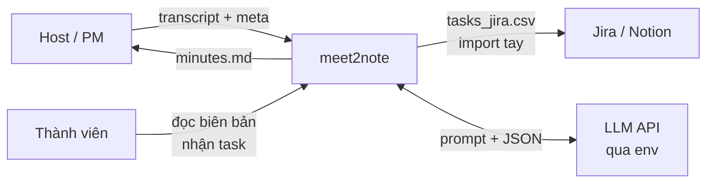

# C4 L1 — Context: meet2note là gì, ai dùng, tương tác với gì

## Phạm vi hệ thống

meet2note nhận **transcript có sẵn (.txt/.srt + timestamp + speaker)** và meta cuộc họp,
trả ra **trạng thái có cấu trúc** (Decision / Task / Blocker / Requirement / Open Issue / Evidence)
kèm evidence, để host confirm trong 2 phút rồi export biên bản + task import Jira.

Hệ thống KHÔNG làm: thu âm, ASR/diarization, realtime, bot join họp, sync API 2 chiều.

## Actors & hệ ngoài

| Đối tượng | Tương tác |
|---|---|
| Host / PM | Đưa transcript + meta, review 2 phút, confirm, export |
| Thành viên | Đọc biên bản, nhận task của mình |
| LLM API (ngoài) | Nhận prompt + chunk transcript, trả JSON có cấu trúc (qua env, không khóa vendor) |
| Jira / Notion (ngoài) | Nhận file CSV import tay — MVP không gọi API |

