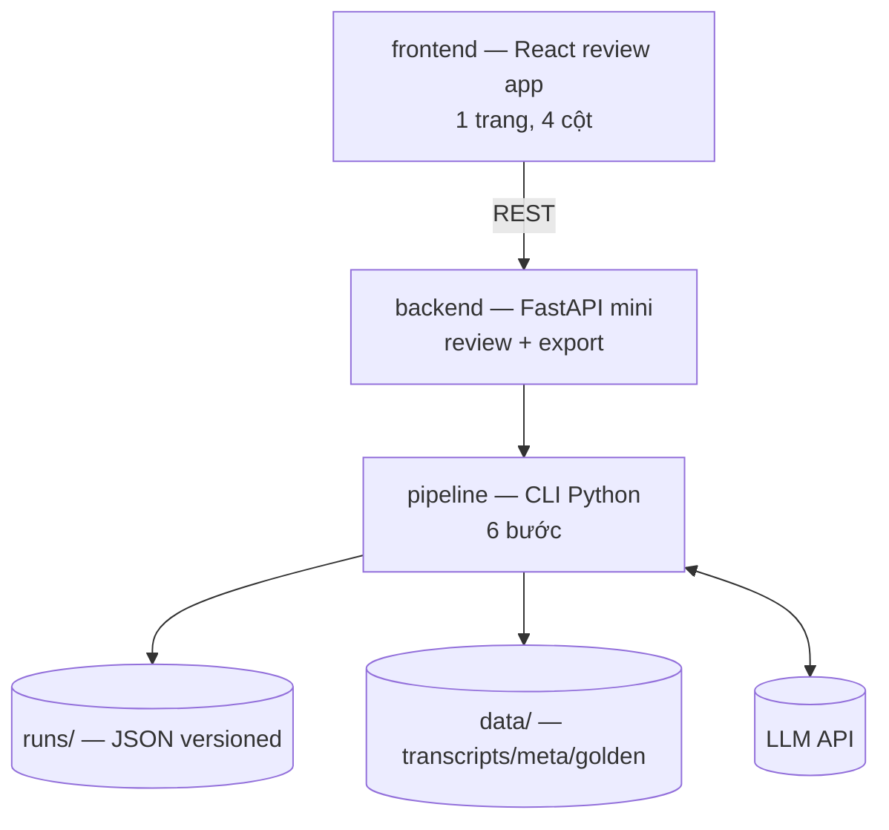

# C4 L2 — Container: các khối chạy được

| Container | Công nghệ | Trách nhiệm |
|---|---|---|
| `frontend` — review app | React (Vite), 1 trang | Hiển thị 4 cột, badge confidence, sửa owner/due, gate thẻ đỏ, nút Export |
| `backend` — API mini | FastAPI | `GET/PUT /api/v1/review` (đọc/ghi state), `POST /api/v1/export` (chặn khi còn thẻ đỏ) |
| `pipeline` — CLI | Python + Pydantic v2 | `run / eval`: ingest→extract→resolve→verify→export→store, chạy độc lập không cần server |
| `runs/` — filesystem | JSON files | `runs/<meeting_id>/<ts>/`: state, confirmed, review_log, llm_log (versioned, thay DB ở MVP) |
| `data/` — fixtures | `.txt/.srt` + JSON | transcripts tc1–tc5, meta, golden để eval |

MVP chạy được pipeline CLI mà không cần frontend/backend (xem `runbook/local-dev.md`).
