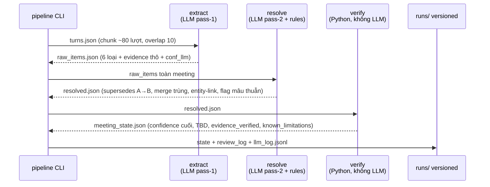

# C4 L3 — Component: chi tiết pipeline (lõi MVP)

6 bước, input/output file rõ ràng. Bước (4) VERIFY thuần Python — mọi lời LLM đều bị code kiểm tra lại.

| Bước | Module | LLM? | Việc chính |
|---|---|---|---|
| (1) INGEST | `ingest.py` | Không | Parse txt/srt → `turns.json` [{turn, t_start, t_end, speaker, text}] |
| (2) EXTRACT | `extract.py` | Có (pass-1) | Trích 6 loại + evidence + conf_llm, temp 0, JSON mode, retry ≤2 |
| (3) RESOLVE | `resolve.py` | Có (pass-2) + rules Python | Nối supersedes xuyên chunk, merge trùng, entity-link tên/ngày, flag `unresolved_reversal` |
| (4) VERIFY | `verify.py` | Không | Quote fuzzy ≥85%, công thức confidence, ép TBD (R1/R2/R5) |
| (5) REVIEW | React + API | Người | Đồng ý/Sửa/Loại, gate R6, ghi review_log |
| (6) EXPORT | `export.py` | Không | `minutes.md` + `tasks_jira.csv`, chỉ chạy sau confirm |

Tách pass-2 vì đề xuất A (đầu họp) và chốt B (cuối họp) nằm khác chunk — pass-1 không thấy toàn cảnh.
Chi tiết schema + quy tắc: `spec/taxonomy.md`.
